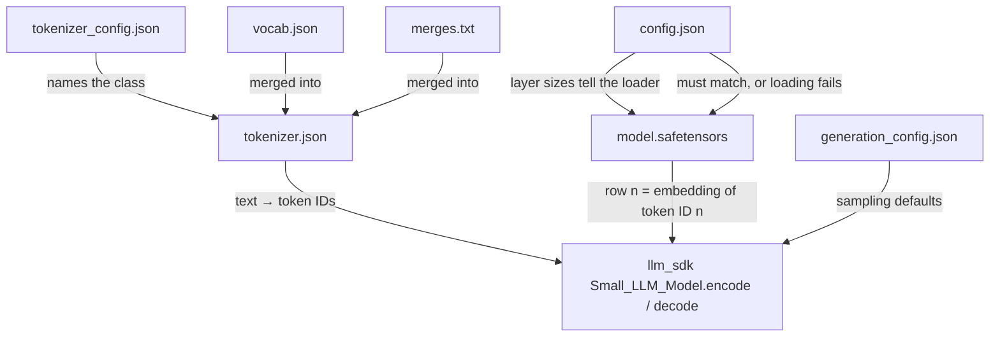
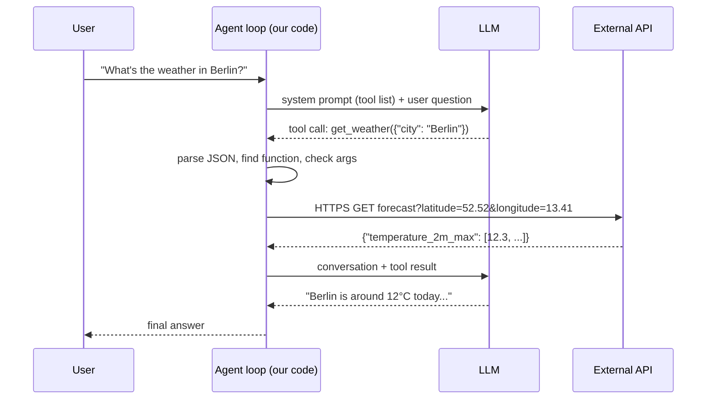

# Call-me-maybe Ecole 42

### I've started with exploring how function calling systems and constraint 
### decoding works and where i can try it
## lreycache !!! openaigithub

## https://docs.z.ai/guides/capabilities/function-calling#file-operations
## https://platform.claude.com/docs/en/agents-and-tools/tool-use/define-tools
## https://developers.openai.com/api/docs/guides/function-calling?api-mode=responses /// BEST PRACTICES
## https://openai.com/index/introducing-structured-outputs-in-the-api/
## https://platform.claude.com/docs/en/build-with-claude/structured-outputs
## https://kushalranaai.github.io/Learn_llm/learn/model-foundations/what-is-an-llm/inside-a-transformer/ // VERYVERY NICE
## https://prakashkagitha.github.io/llm-stack-book/07-inference-serving/10-structured-generation.html
## https://engineersofai.com/docs/llms/structured-generation/constrained-decoding

**Function calling** (also known as tool-calling) is a method by which models
can reliably connect and interact with external tools or APIs.
**LLM** is a type of artificial intelligence (AI) program trained on massive
amounts of text data to understand, summarize, translate, and generate
human-like language.

**Tokenization** is the process of breaking raw text down into smaller pieces
(words, sub-words, or characters) so a computer can map them into numerical
IDs and vector embeddings.

**Neural network** is a computer system modeled loosely after the human brain
that learns to recognize patterns and make decisions.

**BPE tokenizer** is a subword tokenization algorithm used by large language
models (LLMs) like GPT to break raw text into smaller, manageable units
(tokens) before processing.

**AI agent** is an autonomous software system that uses AI to perceive a goal,
plan steps, use external tools, and execute actions on its own.

**Tensor** is the container all deep learning data lives in: a
multi-dimensional array of numbers with a fixed **shape** and a fixed
**dtype** (numerical precision). The name generalizes its special cases:

| Dimensions | Name | Model example |
|---|---|---|
| 0 | scalar | one logit value |
| 1 | vector | one token's embedding: 1024 floats |
| 2 | matrix | whole embedding table: `[151936, 1024]` |
| 3 | 3-D tensor | one transformer layer's input: `[batch=1, seq_len, 1024]` |

A tensor is more than raw memory: it stores shape and dtype *alongside* the
data, so operations like `A @ B` (matrix multiply) can check shapes before
touching a single number, and GPU kernels know the memory layout without
copying. Every step in this repo's pipeline is a tensor flowing into the next:
text becomes a `[1, seq_len]` tensor of token IDs, the embedding lookup turns
it into `[1, seq_len, 1024]` floats, 28 layers reshape those numbers, and the
final projection produces one `[151936]` vector of logits. Same object type
end to end - only the shapes change.

**Parameter** is one learnable number inside the model - a single float in
any weight matrix. "Qwen3-0.6B" is named after them: ~0.6 billion parameters,
each a float adjusted during training and frozen at inference.

LLM is two files: file of weights (tons of floats) and a short runner program.
Parameter weights file acts as a compressed representation of knowledge.
Runtime file executes the mathematical operations to process tokens.

---

## How the prompt is being processed

### 1. Tokenization

Text is broken into tokens, which can be words, parts of words, or characters.
Tokenizer splits input string into sub-word units using a lookup table which
typically contains tens of thousands to over a hundred thousand unique tokens.
Tokenization quirks lead to specific failure modes in spelling, math and coding.

Example mapping with BPE tokenization:

```text
Text input:      "How do tokens look like?"
Token chunks:    ["How", " do", " tokens", " look", " like", "?"]
Token IDs:       [4486, 466, 16337, 1445, 588, 30]
```

(Example IDs are illustrative - real IDs come from the tokenizer's vocabulary.)

The LLM never reads raw text strings like "How". It only receives a sequence of
integers: [4486, 466, 16337, 1445, 588, 30].

### 2. Vector Embedding Lookup

Runtime program reads sequence [4486, 466, 16337, 1445, 588, 30] and converts
each token ID into a vector of floating-point numbers by looking up its row in
the embedding matrix stored in the weights file (parameters). Row n of the
matrix IS token ID n, so the lookup is pure indexing, no computation.
After the lookup the model works only on these vectors - meaning is geometry
from here on.

Example embedded representation:

```text
Token ID 4486 ("How")     -> [0.0312, -0.1421, 0.0891, ..., -0.0432]
Token ID 466 (" do")      -> [-0.1042, 0.2214, 0.4120, ..., 0.0811]
Token ID 16337 (" tokens")-> [0.0142, 0.4109, 0.0031, ..., -0.1944]
Token ID 1445 (" look")   -> [0.1294, -0.3204, 0.1552, ..., 0.2103]
Token ID 588 (" like")    -> [-0.2105, 0.1198, -0.0784, ..., -0.0152]
Token ID 30 ("?")         -> [0.0012, -0.0041, 0.0023, ..., -0.0019]
```

### 3. Neural Network Processing

Runtime script passes numerical vectors through consecutive neural network
layers. At each layer, matrix multiplication operations combine vector data
across tokens to determine context and meaning.

### 4. Output Token Generation

The final layer outputs a probability distribution over the entire vocabulary
(roughly 32k-256k possible token ids depending on the model; Qwen3, the model
this repo wraps, has about 151k). The final vector goes through a linear layer
to match the vocabulary size. The raw output numbers are called logits.

Example probability output for the next token:

```text
Token ID 2574 ("Tokens"): 82%
Token ID 466  ("do"):      5%
Token ID 682  ("They"):    3%
```

(top-3 candidates shown; probabilities sum to 100% over the whole vocabulary)

How the next token is picked:

- Greedy decoding: always take the highest-probability token. Deterministic,
  but repetitive and flat.
- Sampling: draw the next token from the distribution, shaped by temperature
  (flattens/sharpens it) and top-p (cuts the long tail). This is what chat
  models do by default - the same prompt can yield different answers.

After picking, the runtime decodes the integer (e.g. 2574) back into text
("Tokens"), displays it, and appends it to the input sequence to generate the
next token - one token per forward pass, repeated until a stop token appears.

## Seeing it in this repo's SDK

The `llm_sdk` package (`Small_LLM_Model`, wraps Qwen3-0.6B) exposes every
stage above as a method:

| Pipeline stage            | SDK method                        |
|---------------------------|-----------------------------------|
| Tokenization              | `encode(text)`                    |
| Embedding lookup          | (inside the forward pass)         |
| Neural network + logits   | `get_logits_from_input_ids(ids)`  |
| Decode                    | `decode(ids)`                     |

The raw tokenizer artifacts (BPE vocabulary, merge rules, merged
`tokenizer.json`) are reachable too: `get_path_to_vocab_file()`,
`get_path_to_merges_file()`, `get_path_to_tokenizer_file()`.

Run the whole pipeline yourself:

```python
from llm_sdk import Small_LLM_Model

m = Small_LLM_Model(device="cpu")
text = "How do tokens look like?"

ids = m.encode(text).tolist()[0]          # stage 1
print(m.decode(ids))                      # stage 4 inverse, sanity check
logits = m.get_logits_from_input_ids(ids) # stage 4
top3 = sorted(range(len(logits)), key=logits.__getitem__, reverse=True)[:3]
print([(i, m.decode([i])) for i in top3])
```

Further reading: [Function calling in LLMs - GeeksforGeeks](https://www.geeksforgeeks.org/artificial-intelligence/function-calling-in-llms)

## Inside the model directory: what each file is and what depends on what

A downloaded model (here: `~/.cache/huggingface/hub/models--Qwen--Qwen3-0.6B/snapshots/<hash>/`)
is just files. There is no magic, no database - the runtime program only reads
them:

```text
snapshot/
├── config.json              ← architecture blueprint (no weights, just numbers)
├── model.safetensors        ← ALL the weights (1.50 GB, ~750M floats in BF16)
├── tokenizer.json           ← fast tokenizer: vocab + merge rules, precompiled
├── vocab.json               ← token string → integer ID (human-readable vocab)
├── merges.txt               ← BPE merge rules: which byte pairs fuse, in order
├── tokenizer_config.json    ← special tokens, chat template, tokenizer class
└── generation_config.json   ← sampling defaults (temperature, top-p, eos)
```

What each file contains (real values from this snapshot):

| File | Role | Key contents |
|---|---|---|
| `config.json` | Architecture | `hidden_size: 1024`, `num_hidden_layers: 28`, 16 attention heads / 8 KV heads (GQA), `intermediate_size: 3072`, `vocab_size: 151936`, context 40960, RoPE theta 1e6 |
| `model.safetensors` | Knowledge | every weight matrix of the 28 layers + the embedding table `model.embed_tokens.weight` of shape `[151936, 1024]` |
| `vocab.json` | Text → ID table | 151,643 real entries (`token string` → integer) |
| `merges.txt` | How to build tokens | ordered list of byte-pair merges; BPE applies them top-to-bottom |
| `tokenizer.json` | Fast tokenizer | same vocab + merges, precompiled into one file for the Rust-backed fast tokenizer |
| `tokenizer_config.json` | Wrapping rules | class name (`Qwen2TokenizerFast`), EOS/pad tokens, chat template |
| `generation_config.json` | Decoding defaults | temperature / top-p / top-k applied *after* logits, plus stop-token ID |

Dependency graph - who reads whom:



The dependencies in words:

1. **`config.json` is read first.** It describes the shape of every tensor:
   number of layers, hidden size, head counts. The loader builds an empty
   network with exactly these shapes and then streams `model.safetensors`
   into it. If the two disagree (e.g. a checkpoint without the embedding
   rows `vocab_size` promises), loading fails.
2. **`model.safetensors` depends on `config.json` for its meaning.** The file
   itself is only a flat bag of floats with tensor names and shapes in a
   small header; without `config.json` the names would still say
   `layers.28.self_attn...` but nothing could interpret the architecture
   around them.
3. **`tokenizer.json` is the merged, precompiled form of `vocab.json` +
   `merges.txt`.** They are redundant by design: the two raw files are for
   humans and slow (Python) tokenizers, the merged one for the fast
   (Rust) tokenizer. Editing `vocab.json` alone changes nothing if the
   fast tokenizer loads `tokenizer.json`.
4. **`tokenizer_config.json` points at which tokenizer class to build** and
   supplies what the vocab cannot: EOS/pad token IDs and the chat template
   that wraps user text before tokenization.
5. **`generation_config.json` is read at generation time, not load time.**
   It never touches the forward pass - it only reshapes the logits the
   forward pass already produced (temperature, top-p) and says which token
   ID means "stop".
6. **The embedding table is the bridge between the two halves.** Token IDs
   from the tokenizer half index rows of `model.embed_tokens.weight` in the
   weights half - that lookup is the entire interface between "text world"
   and "vector world". Row 4340 of the embedding matrix is the vector for
   the token whose `vocab.json` entry is `"How"`.

Everything the SDK exposes maps onto these files: `encode`/`decode` run the
tokenizer files, `get_logits_from_input_ids` runs `config.json` +
`model.safetensors`, and the `get_path_to_*` methods hand you the raw files
so you can inspect them yourself.

---

# Tutorial: build a function-calling system with an external API

Function calling is a loop, not a model feature you buy. The model only ever
does one thing: read text, output text. Everything else - deciding a tool is
needed, calling the API, feeding the result back - is our code. This tutorial
builds that loop from scratch on top of `Small_LLM_Model` and a real, key-free
external API ([Open-Meteo](https://open-meteo.com), weather forecasts).

## The loop in one picture



The model never touches the network. Only our agent code does.

## Step 1 - Describe your tools to the model

The model cannot call a function it has never heard of. We describe each tool
as a JSON schema and inject it into the system prompt:

```python
import json

TOOLS = [
    {
        "name": "get_weather",
        "description": "Get today's weather forecast for a city.",
        "parameters": {
            "type": "object",
            "properties": {
                "city": {"type": "string", "description": "City name"},
            },
            "required": ["city"],
        },
    },
]

SYSTEM = (
    "You are a helpful assistant. You have access to these tools:\n"
    + json.dumps(TOOLS, indent=2)
    + "\nTo use a tool, reply with ONLY a JSON object: "
      '{"name": "...", "arguments": {...}} and nothing else. '
      "If no tool is needed, answer normally."
)
```

Why JSON schema instead of free-form description: the schema doubles as
documentation for the model *and* as a validator for our code. If the model's
arguments do not satisfy the schema, we reject them before the API ever sees
them.

## Step 2 - Implement the tool as a real API call

One Python function per tool, plus a registry so dispatch is a dict lookup:

```python
import urllib.request

GEOCODE_URL  = "https://geocoding-api.open-meteo.com/v1/search?name={city}&count=1"
FORECAST_URL = "https://api.open-meteo.com/v1/forecast"

def _http_json(url: str) -> dict:
    with urllib.request.urlopen(url, timeout=10) as r:
        return json.loads(r.read().decode())

def get_weather(city: str) -> dict:
    geo = _http_json(GEOCODE_URL.format(city=urllib.parse.quote(city)))
    if not geo.get("results"):
        return {"error": f"city not found: {city}"}
    loc = geo["results"][0]
    url = (f"{FORECAST_URL}?latitude={loc['latitude']}"
           f"&longitude={loc['longitude']}"
           f"&current=temperature_2m,wind_speed_10m")
    out = _http_json(url)
    return {"city": loc["name"], **out["current"]}

TOOL_REGISTRY = {"get_weather": get_weather}
```

Two-phase call is typical for real APIs: first resolve a human name into
coordinates (geocoding), then query the actual endpoint.

## Step 3 - Extract the tool call from model output

The model's reply is *text that looks like JSON*. Never trust it - parse
defensively:

```python
def extract_tool_call(text: str) -> dict | None:
    start = text.find("{")
    end   = text.rfind("}")
    if start == -1 or end <= start:
        return None                      # plain answer, no tool call
    try:
        call = json.loads(text[start:end + 1])
    except json.JSONDecodeError:
        return None
    if not (isinstance(call, dict) and "name" in call and "arguments" in call):
        return None
    return call
```

Why brace-slicing instead of `json.loads(text)` directly: small models
routinely wrap the JSON in prose ("Sure! Here is the call: {...}") or emit a
markdown fence. Slicing between the first `{` and last `}` survives both.

## Step 4 - The agent loop

Everything above is glued together here. This is the whole "agent":

```python
import re
from llm_sdk import Small_LLM_Model

m = Small_LLM_Model(device="cpu")

def agent(question: str, max_rounds: int = 3) -> str:
    messages = [
        {"role": "system", "content": SYSTEM},
        {"role": "user", "content": question},
    ]
    for _ in range(max_rounds):
        prompt = m._tokenizer.apply_chat_template(messages, tokenize=False, add_generation_prompt=True)
        ids = m.encode(prompt)
        reply = m.decode(m._model.generate(ids, max_new_tokens=120)[0][ids.shape[1]:])

        call = extract_tool_call(reply)
        if call is None:
            return reply                          # final answer

        fn = TOOL_REGISTRY.get(call["name"])
        if fn is None:
            result = {"error": f"unknown tool: {call['name']}"}
        else:
            try:
                result = fn(**call["arguments"])
            except (TypeError, ValueError) as e:  # bad args from the model
                result = {"error": f"bad arguments: {e}"}

        messages.append({"role": "assistant", "content": reply})
        messages.append({"role": "user", "content": f"Tool result: {json.dumps(result)}"})
    return "I could not complete this with the available tools."
```

Run it:

```python
print(agent("What's the weather in Berlin right now?"))
# -> "Berlin is currently around 8.4°C with wind of 11.2 km/h..."
```

What the loop guarantees:

- **`max_rounds`** bounds the cycle (model → tool → model → ...). Without it,
  a model that keeps requesting tools loops forever.
- **Every tool call is validated twice**: unknown names are rejected by the
  registry lookup, wrong arguments by the `try/except` around `fn(**args)`.
- **Tool results enter the conversation as plain text** - to the model there
  is no difference between "the user said this" and "the API returned this".
  That asymmetry is why untrusted tool output should be treated like user
  input, never as instructions.

## Step 5 - Use the model's native chat template for tools

Qwen3's chat template understands tools natively: pass them to
`apply_chat_template` and special tokens (`<tool_call>...</tool_call>`) mark
the calls, which is more robust than parsing free JSON:

```python
prompt = m._tokenizer.apply_chat_template(
    messages, tokenize=False, add_generation_prompt=True, tools=TOOLS
)
# the reply then contains <tool_call>{"name": "get_weather", "arguments": {"city": "Berlin"}}</tool_call>
```

Extract with the same slicing idea, but around the tags:

```python
def extract_tagged_call(text: str) -> dict | None:
    match = re.search(r"<tool_call>(.*?)</tool_call>", text, re.DOTALL)
    if match is None:
        return None
    try:
        return json.loads(match.group(1))
    except json.JSONDecodeError:
        return None
```

Trade-off: native templates were tuned on large models; Qwen3-0.6B follows
them imperfectly. For a small local model the plain-JSON protocol of Step 1-4
is often more reliable because it is simpler to imitate. Ship the protocol
your model actually obeys.

## Failure modes you will hit, and the fix for each

| Symptom | Cause | Fix |
|---|---|---|
| Model answers the weather from memory | Tool description too vague | State exactly when to call: "You MUST call get_weather for any current-weather question" |
| `json.JSONDecodeError` every round | Model truncates JSON at token limit | Raise `max_new_tokens`; shorten tool descriptions |
| Hallucinated argument names (`location` not `city`) | Schema not enforced | Validate against the schema; return `{"error": ...}` so the model can retry |
| Model invents a tool result | It answered without waiting for the loop | Never let the model see a tool question without the tool result turn; check `extract_tool_call` result strictly |
| Same tool called repeatedly | Result already in context, model re-calls | Cap `max_rounds`; on second call of the same tool, inject `{"error": "already fetched, use the result above"}` |

## Where this connects to the earlier sections

- The tokenizer files decide everything: the tool schema text and API results
  are tokenized with the same BPE rules from `vocab.json`/`merges.txt`.
- `get_logits_from_input_ids` is what `generate` calls once per token; the
  loop above just orchestrates many of those forward passes.
- Function calling is why tokens matter for cost and limits: the tool schema
  rides in the prompt on *every* round, so a 200-token schema costs 200
  tokens × every API round-trip of the conversation.

  3blue1brown: neural networks https://www.3blue1brown.com/?topic=all&lesson=eola-preview&search=neural
  karpathy: tokeninzation  https://hackertube.org/watch/zduSFxRajkE
        amount of tokens spend on particular sequence of characters depends on it's context and position in relation to others
        numbers are not normalized

   https://www.reedbeta.com/blog/programmers-intro-to-unicode/
   https://hackertube.org/watch/jkrNMKz9pWU

---

# What the tokenizer actually does

Two jobs, inverse of each other: `encode` turns text into integer IDs,
`decode` turns IDs back into text. The forward pass never sees a character -
only IDs. Everything downstream inherits the tokenizer's decisions.

## The encode pipeline

Real run against this snapshot's `tokenizer.json`, input
`"How do tokens look like?"`:

1. **Pre-tokenize.** A regex splits the string into chunks so merge rules
   never fuse across a word boundary:

   ```text
   "How do tokens look like?" -> ["How", " do", " tokens", " look", " like", "?"]
   ```

2. **Byte-encode.** Each chunk becomes UTF-8 bytes, then every byte is mapped
   to a printable character. Space (byte `0x20`) becomes `Ġ` - which is why
   `" do"` is stored as `Ġdo`. This is what makes the vocabulary total: any
   string (emoji, Chinese, binary garbage) is encodable, worst case as lone
   bytes.
3. **BPE merges.** Per chunk, apply the rules from `merges.txt` in order
   (151,387 rules, learned during training). Two symbols fuse, the result
   fuses again, until no remaining rule matches. The survivors are vocab
   entries: `"strawberry"` ends as `str + aw + berry`, `"HTTPResponse"` as
   `HTTP + Response`.
4. **Vocab lookup.** Each surviving piece is one row of `vocab.json`
   (151,643 entries) -> its integer ID:

   ```text
   [4340, 653, 11211, 1401, 1075, 30]
   ```

Special tokens skip steps 1-3 entirely. This snapshot has 26 added tokens
(IDs 151643-151668): `<|endoftext|>` 151643, `<|im_start|>` 151644,
`<|im_end|>` 151645, `<tool_call>` 151657, `<think>` 151667. They are pulled
out by string match before any merging - one fixed ID, immune to merges.

`decode` walks the same path backwards: ID -> vocab string -> bytes -> UTF-8
text, `Ġ` back to space. Streaming generation decodes one ID at a time; a
partial multi-byte character at the chunk edge is held back until its bytes
complete - that is the occasional "lagging character" in streamed output.

One arithmetic footnote: `vocab.json` (151,643) + added tokens (26) = 151,669
usable IDs, but `config.json` declares `vocab_size: 151936`, so the embedding
table has rows 151669-151935 that no token ever points at - alignment
padding, paid for in parameters.

## How tokenization hits every piece of the workflow

| Workflow piece | Tokenizer's effect | Real value |
|---|---|---|
| Embedding lookup | ID n indexes row n of the embedding table | row 4340 = `"How"` |
| Context window | Prompt + tool schemas + tool results + reply all count in tokens | the example prompt = 6 tokens |
| Generation length | `max_new_tokens` counts tokens, not lines or words; cutting mid-JSON breaks parsing | tutorial failure: `JSONDecodeError` at 120 tokens |
| Stop condition | Generation halts when the sampler picks a special ID | 151643 `<|endoftext|>`, 151645 `<|im_end|>` |
| Chat template | Wraps messages with special-token IDs before encoding | `<|im_start|>user ... <|im_end|>` |
| Arithmetic | Digits have no merge rules - every digit is its own token, no magnitude signal | `123456789` -> 9 tokens, `3.14159` -> 7 tokens |
| Spelling tasks | Letters are not units; they are fused inside vocab entries | `strawberry` -> `str+aw+berry`, the model never sees the individual `r`s |
| Case and whitespace | A leading space is a different vocab entry, not a variant | `"Hello"` 9707 vs `" hello"` 23811 |
| Non-English text | Rare byte sequences fuse poorly: same meaning, more tokens | `"«Buenos días»"` -> 6 tokens, bytes look like `ĠdÃŃas` |
| Cost and rate limits | APIs bill per token; the tool schema is re-tokenized every round | 200-token schema x every round-trip |

The three most consequential in practice:

- **Position changes the bill.** The merge rules are greedy per chunk, and
  the chunk is decided by the pre-tokenizer split - so where a word sits
  changes its cost: `"Hello"` alone is 1 token, `"Hello!"` is 2, and the same
  sentence gains a token per leading space it picks up. The 200-token tool
  schema of the tutorial is not a fixed cost of your tools; it is a fixed
  cost of how its *text* happens to merge.
- **Numbers are not numbers.** Each digit being a separate token means the
  model sees `123456789` as nine unrelated symbols - no place-value tensor,
  no magnitude. That is a tokenizer decision, not a model decision, and it is
  why LLMs multiply poorly without a calculator tool - one more reason the
  function-calling loop exists.
- **Truncation is a tokenizer event.** `max_new_tokens=120` in Step 4 stops
  the sampler mid-stream; JSON cut in the middle of a key becomes undecodable
  text. When a small model "emits broken JSON", the tokenizer usually stopped
  it, not the model.

Further reading: Karpathy's tokenization deep-dive (linked above) walks
byte-level BPE with this exact vocabulary style.
        ord() in pythn


